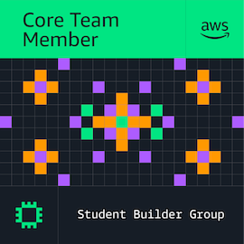
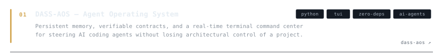
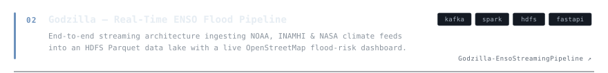
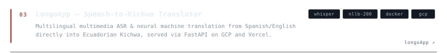
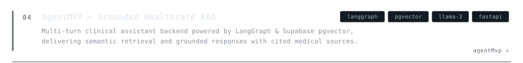
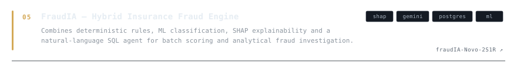
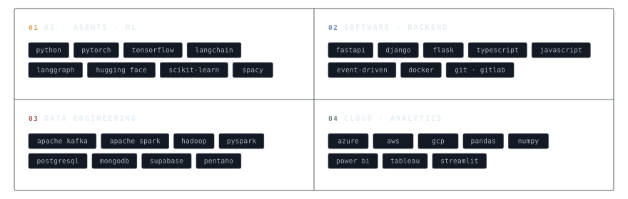
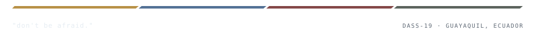

  <picture>
    <source media="(prefers-color-scheme: dark)" srcset="assets/hero-dark.svg" />
    <source media="(prefers-color-scheme: light)" srcset="assets/hero-light.svg" />
    
  </picture>

  
  &nbsp;
  
  &nbsp;
  
  &nbsp;
  

 

  <picture>
    <source media="(prefers-color-scheme: dark)" srcset="assets/sec-01-dark.svg" />
    <source media="(prefers-color-scheme: light)" srcset="assets/sec-01-light.svg" />
    
  </picture>

  
  &nbsp;&nbsp;&nbsp;&nbsp;
  
  &nbsp;&nbsp;&nbsp;&nbsp;
  

  <picture>
    <source media="(prefers-color-scheme: dark)" srcset="assets/highlights-dark.svg" />
    <source media="(prefers-color-scheme: light)" srcset="assets/highlights-light.svg" />
    
  </picture>

 

  <picture>
    <source media="(prefers-color-scheme: dark)" srcset="assets/sec-02-dark.svg" />
    <source media="(prefers-color-scheme: light)" srcset="assets/sec-02-light.svg" />
    
  </picture>

<a href="https://github.com/Dass-19/dass-aos">
  <picture>
    <source media="(prefers-color-scheme: dark)" srcset="assets/work-01-dark.svg" />
    <source media="(prefers-color-scheme: light)" srcset="assets/work-01-light.svg" />
    
  </picture>
</a>
<a href="https://github.com/Dass-19/Godzilla-EnsoStreamingPipeline">
  <picture>
    <source media="(prefers-color-scheme: dark)" srcset="assets/work-02-dark.svg" />
    <source media="(prefers-color-scheme: light)" srcset="assets/work-02-light.svg" />
    
  </picture>
</a>
<a href="https://github.com/Dass-19/longoApp">
  <picture>
    <source media="(prefers-color-scheme: dark)" srcset="assets/work-03-dark.svg" />
    <source media="(prefers-color-scheme: light)" srcset="assets/work-03-light.svg" />
    
  </picture>
</a>
<a href="https://github.com/Dass-19/agentMvp">
  <picture>
    <source media="(prefers-color-scheme: dark)" srcset="assets/work-04-dark.svg" />
    <source media="(prefers-color-scheme: light)" srcset="assets/work-04-light.svg" />
    
  </picture>
</a>
<a href="https://github.com/Dass-19/fraudIA-Novo-2S1R">
  <picture>
    <source media="(prefers-color-scheme: dark)" srcset="assets/work-05-dark.svg" />
    <source media="(prefers-color-scheme: light)" srcset="assets/work-05-light.svg" />
    
  </picture>
</a>

 

  <picture>
    <source media="(prefers-color-scheme: dark)" srcset="assets/sec-03-dark.svg" />
    <source media="(prefers-color-scheme: light)" srcset="assets/sec-03-light.svg" />
    
  </picture>

  <picture>
    <source media="(prefers-color-scheme: dark)" srcset="assets/telemetry-dark.svg" />
    <source media="(prefers-color-scheme: light)" srcset="assets/telemetry-light.svg" />
    
  </picture>

 

  <picture>
    <source media="(prefers-color-scheme: dark)" srcset="assets/sec-04-dark.svg" />
    <source media="(prefers-color-scheme: light)" srcset="assets/sec-04-light.svg" />
    
  </picture>

  <picture>
    <source media="(prefers-color-scheme: dark)" srcset="assets/stack-dark.svg" />
    <source media="(prefers-color-scheme: light)" srcset="assets/stack-light.svg" />
    
  </picture>

 

  <picture>
    <source media="(prefers-color-scheme: dark)" srcset="assets/footer-dark.svg" />
    <source media="(prefers-color-scheme: light)" srcset="assets/footer-light.svg" />
    
  </picture>

